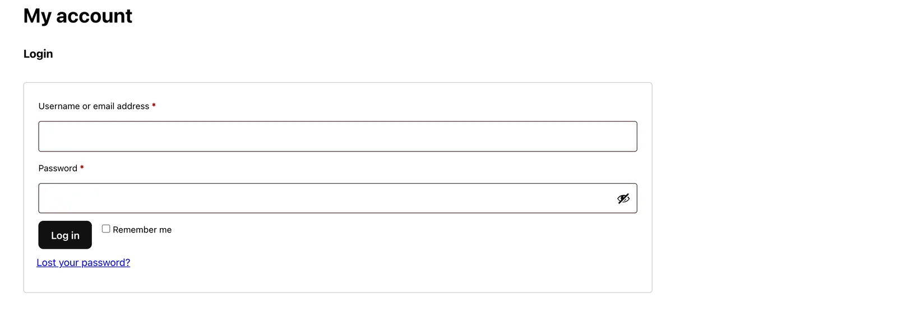

# My account

The **Woo Account** starter turns WooCommerce's My account page into an Etch page. Install it under **Settings → WooCommerce → Starters**: it replaces the page's `[woocommerce_my_account]` shortcode and keeps it in the install record, so **Remove** puts it back.

## What it contains

| Component | What it shows |
| --- | --- |
| **Woo Account** | The page: store notices, then for customers the menu and the content, for guests WooCommerce's login (and registration, if the shop allows it). |
| **Woo Account Nav** | A loop over `woo.account.menu`. The link of the page shown carries `aria-current="page"`. |
| **Woo Account Dashboard** | The account front page: a greeting with `woo.account.name`, the latest orders from `woo.account.orders` and both addresses from `woo.account.addresses`. |

## Which parts stay WooCommerce's

The dashboard is Etch's. The other account pages (orders, order details, downloads, addresses, account details, payment methods) and the login and lost-password forms are WooCommerce's own, so their fields, checks and the plugins that extend them keep working.

- On the account pages other than the dashboard, a **WooCommerce Hook** block runs `woocommerce_account_content`, the same hook WooCommerce's own account page uses.
- For guests, the starter prints WooCommerce's `[woocommerce_my_account]`, which shows the login and lost-password forms.

The conditions `woo.account.is_logged_in` and `woo.account.is_dashboard` choose between the three. Keep them when you rebuild the page.

## Styling WooCommerce's forms

The class `woo-account__woo` wraps WooCommerce's parts. Its style covers headings, form rows, labels, fields, buttons, tables and addresses, all inside `:where()`, so your own classes override it. With WooCommerce's stylesheets loaded, their rules win where they are more specific; leave them out under Settings → WooCommerce to style the forms only with Etch.

The style also sizes WooCommerce's searchable country and state dropdowns. That is the one rule stronger than a class: WooCommerce's stylesheets set conflicting sizes for these dropdowns, and no class of yours reaches their inside.

## Custom properties

| Property | Used for |
| --- | --- |
| `--woo-account-gap` | Space between menu and content |
| `--woo-account-accent`, `--woo-account-accent-text` | The current menu item and buttons |
| `--woo-account-border`, `--woo-account-field-border` | Panels, rows and fields |
| `--woo-account-muted`, `--woo-account-hover` | Secondary text and the menu hover |
