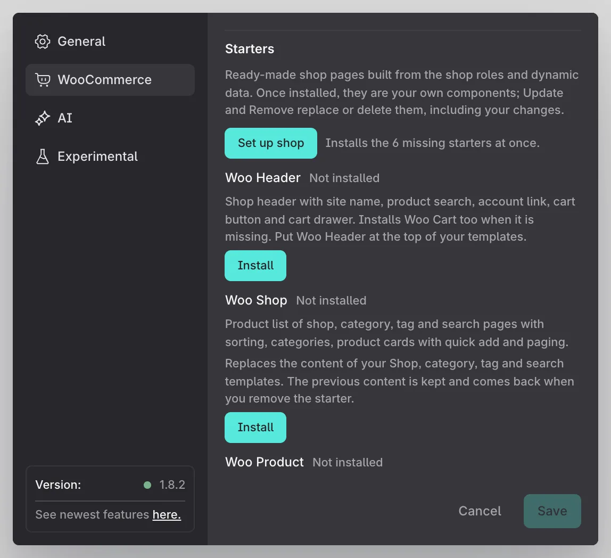
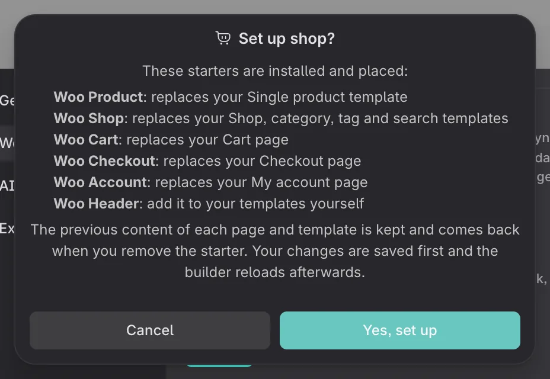
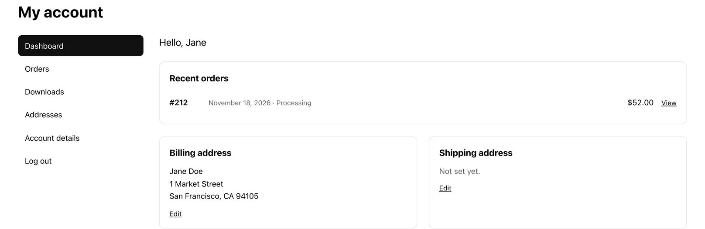
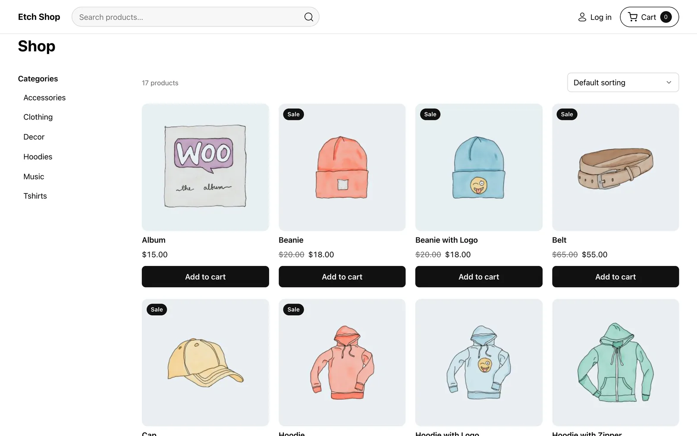
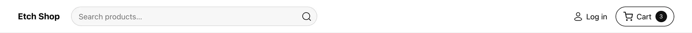

# Get started with WooCommerce

This page walks through setting up a shop with Etch: what you need, what Etch does by itself once WooCommerce is active, and how to install the ready-made shop pages.

## Requirements

- Etch and the Etch theme (or a child theme of it).
- WooCommerce, with its setup finished so that the Shop, Cart, Checkout and My account pages exist (WooCommerce → Settings → Advanced lists them).

There is nothing to switch on. The integration starts as soon as both Etch and WooCommerce are active.

## What happens when WooCommerce is active

Etch adds the integration and leaves your content alone. Nothing is created or placed in your pages until you install a starter.

| Where | What you get |
| --- | --- |
| Dynamic data | `this.woo` on products, and `woo.cart`, `woo.checkout`, `woo.shop`, `woo.account`, `woo.order` and `woo.shipping` everywhere. See [Product data and loops](./product-data.md). |
| Loops | The **WooCommerce Products** loop type. |
| Elements | **Add WooCommerce Hook**, **Store Notices**, **Cart Region**, **Product Region**, **Checkout** and the four checkout pieces in the element bar; all but the hook in the command bar (search "woo"). See [Elements](./woocommerce.md#elements). |
| Templates | A **WooCommerce** group in the template hub with cart, checkout, order confirmation, product search, category, tag and attribute archives. Single product and shop archive are under **Products**. Etch supplies the cart, checkout and order confirmation templates. See [Shop pages and templates](./shop-pages.md). |
| Settings | A **WooCommerce** tab in Etch's settings with the starters and the option to remove WooCommerce's styles. |

Your shop keeps working as before. The cart and checkout pages show WooCommerce's own Cart and Checkout blocks inside Etch's templates until you replace them.

The template hub lists the templates the theme and WooCommerce provide. When you open it, Etch saves them as editable templates, so they appear in the list.

## Install the starters

The six starters are complete, working designs built from regions, dynamic data and WooCommerce's own forms. They are never installed automatically, and Etch never removes WooCommerce's blocks or shortcodes by itself: you install the starters when you want them, and after that they are your own components.

Install them under **Settings → WooCommerce → Starters** in the builder. Each starter has an **Install** button. A starter that belongs on a page or template is placed there when you install it. The page's or template's previous content is kept, and **Remove** puts it back. Installing saves your unsaved changes and then reloads the builder, so it knows the new components and styles.

**Set up shop** at the top of the list installs every missing starter in one go and places each one. It shows first what goes where. The steps below install them one by one.

### 1. Install the cart

Click **Install** next to **Woo Cart**. This adds the components **Woo Cart**, **Woo Cart Lines**, **Woo Cart Totals**, **Woo Cart Shipping**, **Woo Order Bump**, **Woo Cart Drawer** and **Woo Cart Button**, their styles and two loops for the order bump. It puts **Woo Cart** on WooCommerce's cart page in place of WooCommerce's Cart block, inside a section and container with the page title as heading. The component holds only the cart; the section, container and title are ordinary elements of the page.

Then put **Woo Cart Button** and **Woo Cart Drawer** in your header, or install **Woo Header**, which contains both. See [Cart and checkout](./cart-and-checkout.md#the-woo-cart-starter).

### 2. Install the checkout

Click **Install** next to **Woo Checkout**. This adds **Woo Checkout** and **Woo Checkout Summary** and puts **Woo Checkout** on WooCommerce's checkout page in place of WooCommerce's Checkout block, framed like the cart: billing and shipping details in one column, order review and payment in the other.

:::caution Classic checkout
The Etch checkout is WooCommerce's classic checkout. Payment methods and checkout extensions that only support WooCommerce's block checkout do not show in it. Check your payment methods before you replace the Checkout block. See [Checkout](./cart-and-checkout.md#checkout).
:::

### 3. Install the account

Click **Install** next to **Woo Account**. This adds **Woo Account**, **Woo Account Nav** and **Woo Account Dashboard** and puts **Woo Account** on the My account page, framed like the cart. Customers get a menu of the account pages and a dashboard with their latest orders and addresses; the other account pages and the login for guests stay WooCommerce's, styled by the starter. See [My account](./account.md).

### 4. Install the product page

Click **Install** next to **Woo Product**. It puts **Woo Product** into the **Single product** template: gallery, price, WooCommerce's add to cart form with its variation choices, reviews and related products. Germanized's price notes and similar output of other plugins show in it. See [Product pages](./product-pages.md#the-woo-product-starter).

### 5. Install the shop pages

Click **Install** next to **Woo Shop**. It puts the product list into the shop, category, tag and search templates: sorting, categories, product cards with **Add to cart** and paging. See [Shop pages and templates](./shop-pages.md#shop-categories-and-search).

### 6. Add the header

Click **Install** next to **Woo Header**. It adds **Woo Header** with the site name, a product search, a link to My account (**Log in** for guests) and the cart button and drawer of **Woo Cart**. Woo Header needs Woo Cart, so it installs Woo Cart too when it is missing, without placing it on the cart page.

A header has no fixed place, so put **Woo Header** at the top of your templates yourself. To build your own header instead, use its parts: **Woo Product Search**, **Woo Account Link**, **Woo Cart Button** and **Woo Cart Drawer**.

### 7. Check the result

- Add a product to the cart from a product page and from a shop card: the count in the header and the cart drawer update without a reload.
- Change a quantity, apply a coupon and remove a line on the cart page.
- Open the checkout: your payment methods and the fields plugins add (legal checkboxes, newsletter opt-ins) are there. Place a test order.

The starters work on phones too: the header puts the search on its own row, the categories wrap and the cart drawer takes the full width.

## Good to know

- **Starters belong to you after installing.** Restyle and change them like any component. Updating Etch does not change installed starters.
- **No update in place.** The settings show which starters are installed. To get a newer version of a starter, remove it and install it again; **your changes to the starter are lost**.
- **Remove** deletes the starter's components, the styles and loops it added, and puts back what its pages and templates held before. The dialog asks first. It names the pages edited since installing, whose edits are lost, and other content that uses the starter, which loses those elements. Styles that another installed starter also uses stay. A starter that another installed starter needs (Woo Cart while Woo Header is installed) can only be removed after that one.
- **Side gutter.** The section a starter is placed in carries the class `woo-section`, and Woo Header has its own, with `padding-inline: var(--gutter, clamp(1rem, 5vw, 2.5rem))`. With Automatic.css that is ACSS's gutter, so nothing changes; without it, content keeps a margin to the screen edge. Change the class to set your own.
- **With WP-CLI**, the same works from the command line: `wp etch starter install woo-cart --place` (without `--place` the components are added but not placed), `wp etch starter remove woo-cart` (`--force` when other content uses it) and `wp etch starter list` for what is installed.
- **Existing styles win.** If your site already has a class with the same selector as a starter style, the starter uses your class and keeps its CSS.
- **Your own design instead of a starter.** Everything the starters do is available as elements and dynamic data. Start from an empty page and use the elements from the element bar. See [Cart and checkout](./cart-and-checkout.md) and [Product pages](./product-pages.md).
- **WooCommerce's styles.** Once your templates style the shop themselves, you can leave WooCommerce's stylesheets out under Settings → WooCommerce. See [Remove default WooCommerce styles](./woocommerce.md#remove-default-woocommerce-styles).
