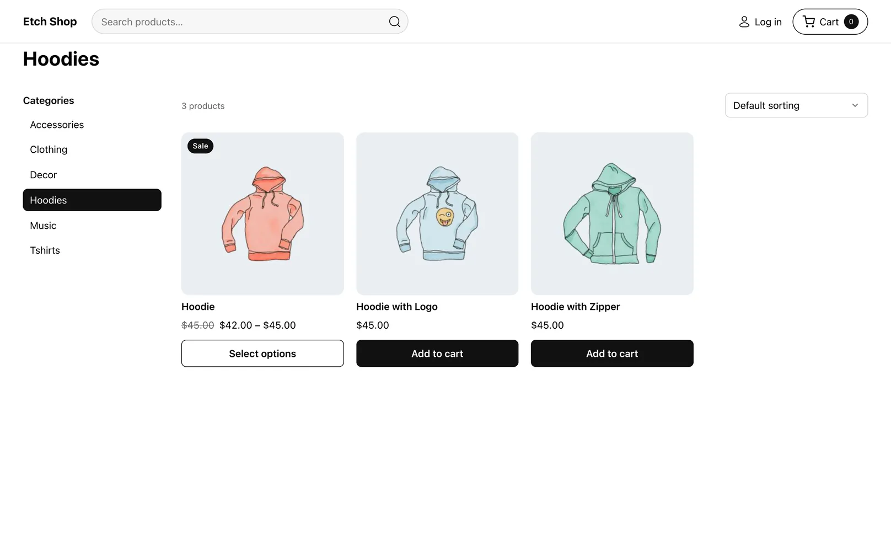

# Shop pages and templates

A WooCommerce shop has two kinds of screens: **pages** that exist once (cart, checkout, account) and **templates** that WordPress fills with whatever is shown (a product, a category, the shop). Etch follows WordPress here.

**Rule of thumb:** the page holds the content, the template is the frame around it.

## Where you edit what

| Screen | Edit the content in | Frame (header, footer, `main`) |
| --- | --- | --- |
| Cart | the **Cart page** (WooCommerce → Settings → Advanced) | template **Cart** (`page-cart`) |
| Checkout | the **Checkout page** | template **Checkout** (`page-checkout`) |
| My account | the **My account page** | your normal page template (`page`) |
| Order confirmation | template **Order Confirmation** (`order-confirmation`) | the same template |
| Single product | template **Single Product** (`single-product`) | the same template |
| Shop | template **Products Archive** (`archive-product`) | the same template |
| Product category | template **Product Category Archive** (`taxonomy-product_cat`), or one per category such as `taxonomy-product_cat-wine` | the same template |
| Product search | template **Product Search Results** | the same template |

The templates are listed in the template hub under **WooCommerce**. Single product and shop archive are under **Products**.

## Cart and checkout

WooCommerce shows its cart and checkout pages through the templates **Cart** and **Checkout**, whatever template the page itself selects. With the Etch theme, Etch supplies both, and the **Order Confirmation** template: each is an Etch `main` element with WooCommerce's store notices and the content. On the Cart template the notices sit in a [cart region](./cart-and-checkout.md#cart-regions), so they update after background cart actions. A template you saved in the template hub wins over Etch's.

Keep these templates as a frame: header, a `main` element with the store notices and the post content inside it, footer.

```html
<SiteHeader />
<main id="main" class="site-main">
  {@post-content}
</main>
<SiteFooter />
```

The cart or checkout itself goes into the page. Installing a starter with placement does exactly that: the checkout component lands in the checkout page, and the frame stays in the template.

A frame of its own is useful for the checkout. Give the **Checkout** template a reduced header (logo, help link, no navigation) and the checkout page keeps its content.

Keep the store notices in an edited Cart or Checkout template. Without them, a page that keeps WooCommerce's Cart or Checkout block shows no notices.

### WooCommerce's own cart or checkout

The cart and checkout pages keep WooCommerce's Cart and Checkout blocks until you replace them, so the shop works as before. The **Woo Cart** and **Woo Checkout** starters replace them, and **Remove** puts them back.

To go back by hand, for example because a payment plugin needs WooCommerce's block checkout:

1. Open the cart or checkout page in the block editor (Pages → Cart → Edit).
2. Delete every block on the page.
3. Add a new **Cart** or **Checkout** block from WooCommerce and save.

The template stays the frame around it.

## Shop, categories and search

**Woo Shop** (Settings → WooCommerce → Starters) puts one product list into the **Product Catalog**, **Products by Category**, **Products by Tag** and **Product Search Results** templates. Each saved template is kept and comes back when you remove the starter.

| Component | What it shows |
| --- | --- |
| **Woo Shop** | WooCommerce's notices, title (`woo.shop.title`), category description, product count, WooCommerce's sorting, categories, the grid and paging |
| **Woo Shop Grid** | One card per product of the page (`woo.shop.products`): image, sale badge, regular and sale price, and **Add to cart** for simple products in stock (`quick_add`), a link to the product with WooCommerce's button text for the others |
| **Woo Shop Categories** | The top-level categories (`woo.shop.categories`), the one shown marked with `aria-current` |
| **Woo Shop Pagination** | Previous, page numbers and next (`woo.shop.pages`) |

The products are the page's own, so WooCommerce's sorting, filters, paging and the shop's products per page apply.



**Add to cart** on a card is WooCommerce's ajax add to cart button (the classes `add_to_cart_button ajax_add_to_cart`). It adds the product without leaving the page, and the cart regions on the page, such as the header count and the drawer, update. Without JavaScript it posts `add-to-cart` and reloads the page.

The sorting is WooCommerce's own sorting form: a GET form with the class `woocommerce-ordering` and a `select` with `name="orderby"` and the class `orderby`. Choosing an order submits it, as WooCommerce's own dropdown does; without JavaScript a **Sort** button does. The form keeps the search terms, category and tag. Other filters in the URL, such as WooCommerce's layered navigation, are dropped when sorting.

## Order confirmation

The order confirmation is not a page. WooCommerce shows it at the end of the checkout URL (`/checkout/order-received/…`), so its content lives in the template **Order Confirmation**. Etch's version shows WooCommerce's order confirmation blocks (status, summary, totals, downloads and addresses) inside an Etch section. To design it yourself, read the order from `woo.order`, and place a hook block on `woocommerce_thankyou` for the payment method's instructions, such as bank details.

## Pages with their own frame

Any page can get a different frame. Create a custom template (for example "Legal" with a side navigation, or "Focus" without header and footer) and choose it in the page settings. The content stays in the page.

## Templates come back

Etch keeps the templates that the theme and plugins provide. If you delete one, Etch creates it again the next time you open the builder, with the default content of the theme or plugin. Delete only templates you created yourself. To use a different frame for a WooCommerce screen, edit its template instead.
