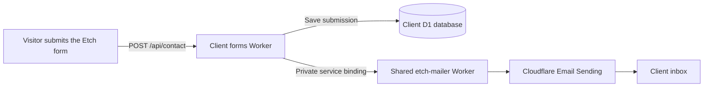

# Etch Forms

Etch Forms is a self-hosted form handler for sites built with Etch Studio. It
receives contact form submissions, saves them in your Cloudflare account and
sends an email notification.

**Self-hosted** means that your agency runs the service in its own Cloudflare
account. Cloudflare provides the servers, database and email delivery, but your
clients' submissions do not pass through an Etch Forms account owned by someone
else.

Etch Forms is designed for agencies that manage more than one client site. Each
client gets separate storage and settings.

## Why there are two Workers

A **Cloudflare Worker** is a small program that runs on Cloudflare's network.
Etch Forms uses two types of Worker:

1. **Etch Mailer** sends email through
   [Cloudflare Email Sending](https://developers.cloudflare.com/email-service/).
   You deploy it once in your agency's Cloudflare account.
2. **Etch Forms** receives submissions for one client site. You deploy a
   separate copy for every client.

The forms Worker saves each submission in that client's **D1 database**.
[Cloudflare D1](https://developers.cloudflare.com/d1/) is a hosted SQL database.
The forms Worker then asks the shared mailer to send the notification through a
private **service binding**, which is a connection between two Workers in the
same Cloudflare account.

The mailer has no public sending page and stores no submission data. A visitor
cannot use its web address to send email.

## Request flow

Before saving a submission, the forms Worker checks the website address that
sent it, a hidden spam-trap field, field values and submission limits. Optional
[Turnstile protection](turnstile.md) adds another spam check.

## What you will install

1. Install the shared mailer once for the agency.
2. Install one forms Worker and one D1 database for the first client.
3. Repeat the second installation for every additional client.
4. Paste each forms Worker's action URL into the matching Etch form.

The forms Worker's home page shows the exact action URL and field names after
deployment.

## Continue

Start with [Before you start](before-you-start.md). Do not deploy a client forms
Worker until the shared mailer is ready.

The source code is available in the
[Etch Forms repository](https://github.com/kevingeary/etch-forms).
